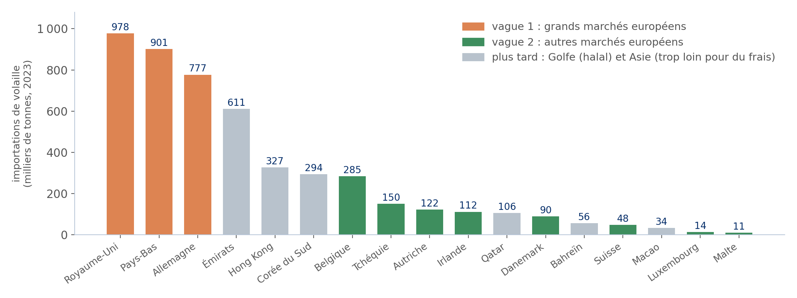
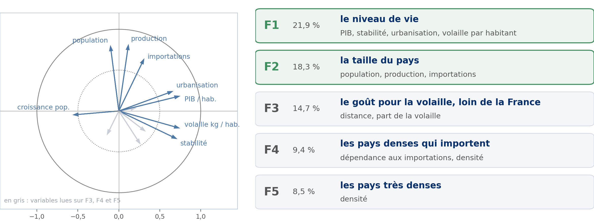
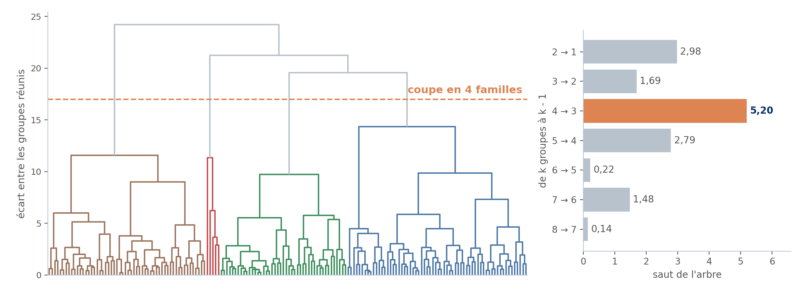
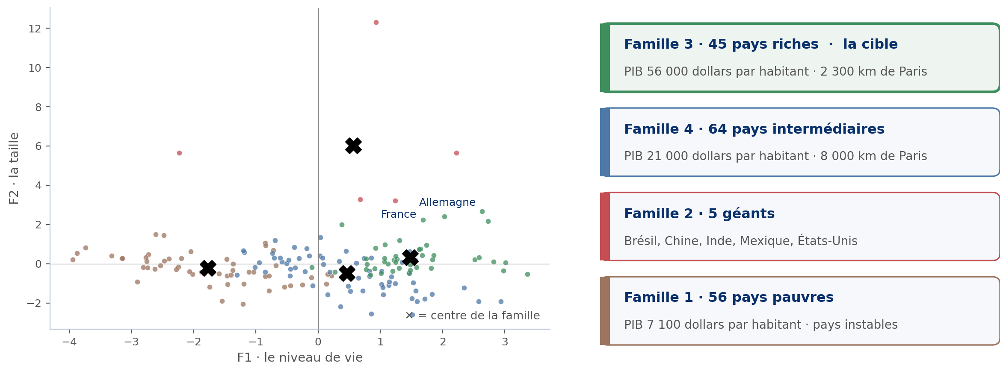
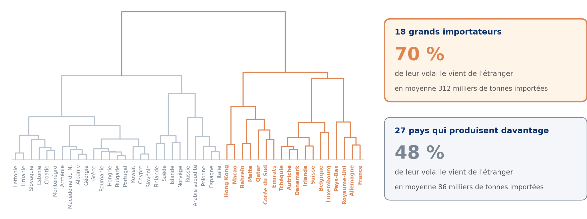

# 🌍 Étude de marché par clustering : choisir les pays où exporter de la volaille bio


170 pays. 12 variables. 4 familles de pays. Un producteur français de poulets bio voulait exporter **sans écarter aucun pays au départ** : l'analyse ramène le monde entier à **3 marchés prioritaires**, le Royaume-Uni, les Pays-Bas et l'Allemagne.



---

## 📖 Contexte

Une entreprise agroalimentaire française, spécialisée dans le poulet bio, veut se développer à l'international. Aucun pays ni aucun continent n'est fixé au départ.

**La question de la direction :** quels pays se ressemblent, et dans quel groupe de pays a-t-on le plus de chances de vendre ?

---

## 🎯 Ce que j'ai fait

1. **Choisi des données récentes.** Les bilans alimentaires de départ dataient de 2017. J'ai pris les bilans de la FAO pour **2023**, la dernière année publiée, pour tenir compte du Covid, de la guerre en Ukraine et du Brexit.
2. **Complété la FAO avec la Banque mondiale**, en choisissant les indicateurs avec la grille PESTEL : PIB par habitant en parité de pouvoir d'achat, stabilité politique, urbanisation, densité.
3. **Créé 4 variables** : la part de la volaille dans la viande consommée, la croissance de la population sur 10 ans, la dépendance aux importations et la distance avec la France (formule de haversine).
4. **Construit un tableau propre** : 170 pays, 94,2 % de la population mondiale, 12 variables, aucune case vide.
5. **Résumé les 12 variables avec une ACP**, puis **regroupé les pays** avec une classification ascendante hiérarchique (méthode de Ward) et un k-means.
6. **Zoomé sur la famille des pays riches** pour isoler les grands importateurs, puis classé les pays par volume importé.

---

## 🔍 Résultats clés

### 1️⃣ 5 axes gardent 72,8 % de l'information

L'ACP résume les 12 variables en 5 axes lisibles : le niveau de vie (F1), la taille du pays (F2), le goût pour la volaille loin de la France (F3), les pays denses qui importent (F4) et les pays très denses (F5).



```python
acp = PCA().fit(X)                                   # X : les 12 variables centrées-réduites
part = acp.explained_variance_ratio_ * 100           # % d'information de chaque axe
cumul = part.cumsum()
# F1 21,9 % · F2 18,3 % · F3 14,7 % · F4 9,4 % · F5 8,5 % → 72,8 % cumulés
```

### 2️⃣ 4 familles de pays, confirmées par deux méthodes

La CAH coupe l'arbre en 4 familles : c'est là que se trouve **le plus grand saut de l'arbre (5,20)**, et la silhouette est aussi la meilleure à 4 groupes (0,276). Le k-means range **82 % des pays** de la même façon.



```python
fusions = linkage(coord_pays, method="ward")     # coord_pays : les 170 pays sur les 5 axes
hauteurs = fusions[:, 2]
sauts = {k: hauteurs[-(k - 1)] - hauteurs[-k] for k in range(2, 9)}
# le saut le plus grand : de 4 à 3 groupes (5,20) → 4 familles

pays["groupe_cah"] = fcluster(fusions, 4, criterion="maxclust")
kmeans = KMeans(n_clusters=4, n_init=20, random_state=42).fit(coord_pays)
# les deux méthodes rangent ensemble 82 % des pays
```

| Famille | Pays | Portrait |
|---|---|---|
| **Pays riches et stables** | 45 | PIB de 56 000 dollars par habitant, à 2 300 km de Paris en moyenne : **la cible** |
| Pays intermédiaires | 64 | PIB de 21 000 dollars par habitant, à 8 000 km de Paris |
| Géants | 5 | Brésil, Chine, Inde, Mexique, États-Unis |
| Pays à faible revenu | 56 | PIB de 7 100 dollars par habitant, stabilité politique faible |



### 3️⃣ Dans la famille riche, 18 pays importent 70 % de leur volaille

Une seconde CAH, sur les 45 pays riches seulement, les sépare en deux : **18 grands importateurs**, dont 70 % de la volaille vient de l'étranger, et 27 pays qui produisent davantage.



### 4️⃣ 3 marchés prioritaires, à commencer par l'Allemagne

| Pays | Volaille importée (2023) | Part importée | Distance de Paris |
|---|---|---|---|
| Royaume-Uni | 978 milliers de tonnes | 36 % | 343 km |
| Pays-Bas | 901 milliers de tonnes | 100 % | 430 km |
| Allemagne | 777 milliers de tonnes | 52 % | 878 km |

---

## 💡 Conclusion et recommandations

> **Sur 170 pays, trois voisins européens réunissent tout ce que cherche un exportateur de poulet bio : un fort pouvoir d'achat, de gros volumes déjà importés et une distance compatible avec le frais.**

1. **Première vague : Allemagne, Pays-Bas, Royaume-Uni.** Commencer par l'Allemagne : premier marché bio d'Europe (rapport annuel du FiBL et de l'IFOAM), dans le marché unique, sans droits de douane. Les Pays-Bas servent de plateforme logistique vers le reste de l'Europe ; le Royaume-Uni apporte le plus gros volume, avec les formalités douanières d'après le Brexit.
2. **Deuxième vague : les autres marchés européens du groupe** : Belgique, Tchéquie, Autriche, Irlande, Danemark, Suisse, Luxembourg.
3. **Les pays du Golfe et l'Asie** (Émirats, Qatar, Hong Kong, Corée du Sud) achètent beaucoup, mais demandent une offre adaptée : certification halal pour le Golfe, produit surgelé pour l'Asie, trop loin pour du frais.

---

## 🛠️ Technologies utilisées

- **Python 3.12** : langage
- **Pandas / NumPy** : préparation, jointures, variables créées
- **scikit-learn** : centrage-réduction, ACP, k-means, silhouette
- **SciPy** : classification ascendante hiérarchique (Ward), dendrogrammes
- **Matplotlib / Seaborn** : éboulis, cercles des corrélations, cartes des pays, radars
- **Jupyter Notebook** : analyse documentée étape par étape

---

## 🚀 Lancer le projet

```bash
git clone https://github.com/Heltondsm/python-etude-marche-clustering-pays.git
cd python-etude-marche-clustering-pays
pip install -r requirements.txt
jupyter notebook notebooks/
```

Lancer `01_preparation_donnees.ipynb` (il écrit `data/pays_prepares.csv`), puis `02_acp_clustering.ipynb`.

---

## 📂 Structure du projet

```
.
├── README.md
├── requirements.txt
├── notebooks/
│   ├── 01_preparation_donnees.ipynb   # FAO + Banque mondiale → 170 pays × 12 variables
│   └── 02_acp_clustering.ipynb        # ACP, CAH, k-means, zoom, pays recommandés
├── data/
│   ├── DisponibiliteAlimentaire_2023.csv   # bilans alimentaires FAO 2023
│   ├── Population_2000_2023.csv            # population FAO
│   ├── bm_*.csv                            # indicateurs Banque mondiale
│   └── pays_prepares.csv                   # le tableau final (sortie du notebook 1)
└── captures/
```

**Sources :** [FAOSTAT](https://www.fao.org/faostat/fr/) (bilans alimentaires et population) · [Banque mondiale](https://data.worldbank.org/) (PIB par habitant en PPA, urbanisation, densité, stabilité politique des Worldwide Governance Indicators, coordonnées des capitales).

---

## 📈 Compétences démontrées

### Préparation des données
- ✅ Deux sources internationales (FAO, Banque mondiale) reliées pays par pays, noms harmonisés
- ✅ Choix des indicateurs guidé par une grille PESTEL
- ✅ 4 variables créées, dont une distance géographique calculée (haversine)
- ✅ Couverture contrôlée : 170 pays, 94,2 % de la population mondiale, aucune case vide

### Analyse
- ✅ ACP : choix du nombre d'axes (éboulis), lecture des cercles des corrélations, nom donné à chaque axe
- ✅ CAH de Ward : nombre de groupes choisi sur le plus grand saut de l'arbre et la silhouette
- ✅ k-means comparé à la CAH (tableau croisé, 82 % d'accord) et mise à l'échelle robuste testée puis écartée, chiffres à l'appui
- ✅ Seconde segmentation à l'intérieur de la famille cible

### Restitution
- ✅ Portrait de chaque famille en mots simples, radars par famille
- ✅ Liste de pays classée et recommandations en deux vagues, présentées à un comité de direction non technique

---

## 📧 Contact

**Helton Dos Santos Moreira**
Data Analyst | 10 ans d'expérience business (retail et e-commerce)

- 📧 Email : heltonmail8@gmail.com
- 💼 LinkedIn : [in/helton-dsm-data](https://linkedin.com/in/helton-dsm-data)
- 🐙 GitHub : [Heltondsm](https://github.com/Heltondsm)
- 🌐 Portfolio : [heltondsm.github.io](https://heltondsm.github.io/)

---

## 🔗 Autres projets

- [CRM data et agents IA : centraliser opportunités, contacts et échanges](https://github.com/Heltondsm/crm-data-agents-ia), PostgreSQL alimenté par des API, collecte Python planifiée, opportunités notées par IA, testé automatiquement à chaque push
- [Tableau de bord Power BI : portefeuille de projets](https://github.com/Heltondsm/powerbi-portefeuille-projets-rls), 104 projets dans 52 pays, sécurité au niveau des lignes sur 3 rôles, 25 mesures DAX
- [Audit de la qualité des données d'un catalogue e-commerce](https://github.com/Heltondsm/python-audit-donnees-catalogue), 3 sources réconciliées, 9 anomalies, 276 859 € de stock valorisé
- [Tendances du streaming musical : tests statistiques et Prophet](https://github.com/Heltondsm/analyse-streaming-musical), 114 000 morceaux, 3 tests avec leur taille d'effet, prévision à 6 mois
- [Pipeline dbt : profils sociodémographiques](https://github.com/Heltondsm/dbt-demographics-pipeline), Snowflake et DuckDB, 26 tests, reproductible en une commande

---

**Projet réalisé en novembre 2026**
